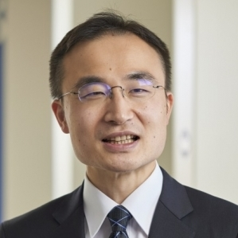

::: {.home-hero}
::: {.hero-copy}
::: {.eyebrow}
SOKA UNIVERSITY · JAPAN
:::

# Shun Chonabayashi

::: {.japanese-name lang="ja"}
蝶名林 俊
:::

::: {.hero-role}
Environmental and Development Economist
:::

Associate Professor · Faculty of Economics and Business Administration

::: {.hero-topics}
Climate change · Agriculture · Poverty · Applied econometrics
:::

[Explore my research](research.qmd){.btn .btn-primary} [View CV](cv.qmd){.btn .btn-outline-primary}
:::

{.hero-portrait width=290 height=363}
:::

::: {.home-grid}
::: {.home-section}
::: {.eyebrow}
RESEARCH
:::

## Environment, development, and human well-being

My research examines how climate change and environmental degradation affect agriculture and poverty in low- and middle-income countries. I combine applied econometrics, geospatial data, remote sensing, and household surveys to assess these impacts and evaluate adaptation policies.

I am an Associate Professor at Soka University and a former World Bank economist. I hold a Ph.D. in Natural Resources from Cornell University, an M.A. in International and Development Economics from Yale University, and a B.A. in Economics from Soka University.

[Soka University faculty profile (Japanese)](https://www.soka.ac.jp/economics/to-high-school-students/faculty-message/#bid-635610)
:::

::: {.home-section .highlights}
::: {.eyebrow}
HIGHLIGHTS
:::

## Recent work and recognition

- **November 13, 2026 · Forthcoming presentation**\
  I will present research on ecosystem services, land-use change, and development pathways in Thailand at the 20th Environment for Development Annual Meeting, IIM Kozhikode, India. [Conference programme](https://iimk.ac.in/apps/efdconf2026/program.html#ps5).
- **2026 · Global Green Growth Index**\
  As a member of the International Expert Group, I contribute to the Index, which received the [Innovative Impact Award at the AI for Good Global Summit 2026](https://gggi.org/global-green-growth-index-receives-ai-for-good-innovative-impact-award/).
- **2026 · New book chapter**\
  “Estimating the Impact of Droughts and Floods on African Farmers,” published by Edward Elgar. [Publications](research.qmd).
- **2025 · Student achievements**\
  AAERE Best Poster Award for seminar students and the CAS-Net Japan Sustainable Campus Newcomer Award for the Seminar. [Lab and student achievements](Global_Citizenship_Lab.qmd).
:::
:::

::: {.engagement}
::: {.eyebrow}
TEACHING & PUBLIC ENGAGEMENT
:::

## Learning through research. Connecting with society.

My teaching at Soka University includes Environmental Economics (graduate), Econometrics, Economics of Climate Change, Humanistic Economics, and undergraduate research seminars and thesis supervision.

I also give public lectures on climate change, economics, and sustainability, and mentor high-school inquiry projects.

[Student research and mentoring](Global_Citizenship_Lab.qmd) · [Lectures and public engagement](media.qmd)
:::

::: {.quick-links}
**Explore** · [Research](research.qmd) · [CV](cv.qmd) · [Opportunities](hiring.qmd) · [Contact](contact.qmd) · [日本語](Japanese.qmd)
:::
